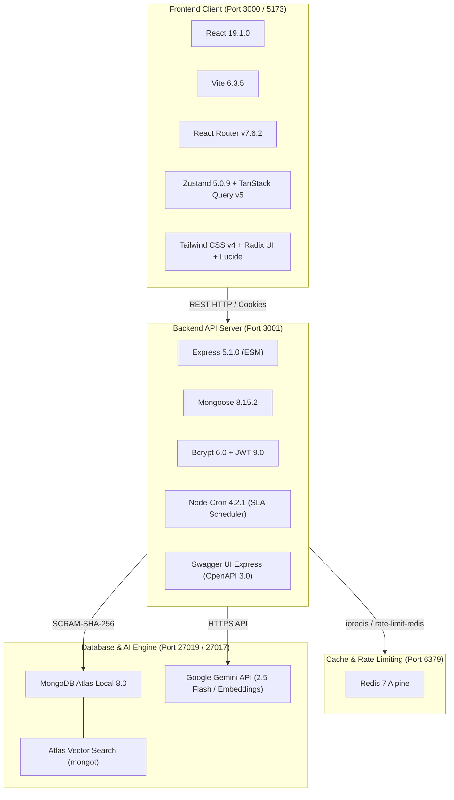

# 01. Project Overview

## What is InsureMed?

**InsureMed** is a full-stack, enterprise-grade Online Health Insurance Management System (OHIMS) designed to modernize health insurance administration. It bridges the gap between insurance policyholders (customers) and insurance underwriters/administrators through a unified digital platform.

The system replaces manual, paper-intensive insurance workflows with digital self-service tools, automated validation, SLA-driven customer support, and an AI-powered conversational policy assistant built with Retrieval-Augmented Generation (RAG).

---

## The Problem InsureMed Solves

Traditional health insurance management often suffers from systemic operational friction:

1. **Fragmented Application Processes:** Customers must navigate opaque paperwork, physical document submission, and slow back-and-forth communication to purchase a policy.
2. **Complex and Inaccessible Policy Terms:** Insurance policy documents are lengthy, dense, and legalistic. Policyholders struggle to determine whether a specific procedure, specialist, or hospital visit is covered under their plan tier.
3. **Slow Claims Processing:** Submitting claims manually results in misplaced invoices, lack of real-time visibility, and prolonged reimbursement cycles.
4. **Poor Support Response Times:** Customer inquiries regarding policy renewals, billing, and claim disputes frequently stall in unmanaged queues without Service Level Agreement (SLA) guarantees.
5. **Administrative Inefficiency:** Insurance administrators lack centralized dashboards to evaluate risk, track financial metrics, adjudicate claims, and enforce operational policies.

---

## Project Objectives

InsureMed achieves the following core objectives:

- **Empower Policyholders:** Provide a self-service portal where customers can compare health insurance plans, submit digital applications with supporting identity documents, manage active policies, file reimbursement claims, and track claim lifecycles in real time.
- **Streamline Administrative Workflows:** Equip insurance administrators with a unified back-office dashboard to create plans, assess underwriting risk scores, review submitted applications, approve or reject claims, and configure global system settings.
- **Enforce Support SLAs:** Automate support ticket workflows with an active background cron scheduler that warns assignees prior to SLA expiration and automatically escalates overdue tickets to emergency status with administrative alerts.
- **Demystify Insurance Coverage with AI:** Implement an intelligent policy assistant using Google Gemini and MongoDB Atlas Vector Search that answers customer policy inquiries strictly grounded in verified policy document chunks, preventing hallucinations.
- **Ensure Security & Compliance:** Protect member data with bcrypt password hashing, JWT-based role authorization, Redis-backed rate limiting, brute-force login protection, and input sanitization.

---

## User Roles & Responsibilities

The system implements Role-Based Access Control (RBAC) with three primary user personas:

| Role | Responsibility & Permissions |
| :--- | :--- |
| **Customer (`customer`)** | - Register and authenticate account with optional email verification. - Browse published insurance plans and view tier details (Individual, Family, Senior, Student, Corporate). - Submit policy applications with personal details, nominee info, medical history, and document uploads. - View issued policies, track effective dates, and request policy renewals. - File reimbursement claims with receipts/invoices and track adjudication status (`Pending`, `Approved`, `Rejected`). - Create support tickets, communicate via threaded messages, and receive notification alerts. - Interact with the AI Assistant to query coverage limits, deductibles, and exclusions. |
| **Administrator (`admin`)** | - Full administrative control over the platform. - Manage insurance plans: create new plans, configure pricing, deductibles, network sizes, preview risk scores, update, and soft-delete. - Adjudicate policy applications: review uploaded documents, approve to generate active policies, or reject with feedback. - Adjudicate claims: examine submitted bills and receipts, set status to `Approved` or `Rejected`. - Manage users: list platform users, view activity summaries, and update user roles. - Manage support tickets: assign tickets to staff, update statuses, respond to messages, and manage FAQs. - Configure global system parameters: tax rates, grace periods, currency, and maintenance mode. |
| **Support Agent (`agent`)** | - Dedicated customer assistance role. - View all customer support tickets across categories (`CLAIM`, `PAYMENT`, `POLICY`, `ACCOUNT`). - Respond to ticket inquiries and update ticket statuses (`OPEN`, `IN_REVIEW`, `WAITING`, `RESOLVED`, `CLOSED`). - Maintain customer communication while adhering to SLA deadlines. |

---

## Core System Modules

1. **Authentication & Identity Management:**
   - Multi-step registration capturing profile, contact, and address data.
   - Secure login with bcrypt hashing and JWT tokens stored in HTTP-only cookies or Authorization headers.
   - Brute-force protection locking accounts after 5 failed attempts for 15 minutes.
   - Password reset flow via crypto-generated tokens and Nodemailer email delivery.

2. **Insurance Plan Catalog:**
   - Public plan browsing with filters for plan type (`individual`, `family`, `senior`, etc.), category, premium range, and ratings.
   - Admin plan builder with automated risk score calculation (`/api/v1/plans/risk-score`).
   - Virtual getters for annualized premium calculations based on payment frequency.

3. **Digital Policy Applications:**
   - Guided application process capturing personal data, nominee details, medical history, and payment preferences.
   - Multi-file document upload handled by Multer.
   - Application lifecycle tracking: `pending` → `approved` (instantiates active policy) or `rejected`.

4. **Policy Lifecycle Management:**
   - Unique policy number generation.
   - Frozen plan snapshots recorded at purchase time to preserve historical coverage terms.
   - Renewal requests (bank transfer or online) and administrative renewal approval.
   - Policy cancellation with reason logging.

5. **Claims Adjudication:**
   - Customer claim filing with document proof (invoices/medical receipts).
   - Claim status tracking: `Pending`, `Approved`, `Rejected`.
   - Admin claim review dashboard with approval/rejection reason logging.

6. **Support Ticketing & SLA Escalation:**
   - Support ticket creation across categories (`CLAIM`, `PAYMENT`, `POLICY`, `ACCOUNT`) with priorities (`LOW`, `MEDIUM`, `HIGH`, `EMERGENCY`).
   - Threaded messaging between customers and support staff.
   - Automated 5-minute background cron job checking SLA deadlines:
     - Sends 1-hour warning alerts to assignees before expiration.
     - Automatically escalates overdue tickets to `EMERGENCY` priority and alerts administration.

7. **AI Conversational Policy Assistant (RAG):**
   - Grounded conversational assistant powered by Google Gemini 2.5 Flash and 768-dimensional vector embeddings.
   - MongoDB Atlas `$vectorSearch` pipeline querying pre-ingested policy document chunks.
   - Strict hallucination guardrails preventing false coverage claims.

8. **Notifications & System Auditing:**
   - User notification center tracking policy updates, claim decisions, and ticket activity.
   - Polling-based frontend synchronization with unread badges.

---

## Technology Stack

### Detailed Component Versions

| Tier | Component | Version | Description |
| :--- | :--- | :--- | :--- |
| **Frontend** | React | `19.1.0` | Declarative component UI library |
| | Vite | `6.3.5` | Next-generation build tool and dev server |
| | React Router DOM | `7.6.2` | Client-side routing and layout rendering |
| | Tailwind CSS | `4.1.10` | Utility-first styling engine with `@tailwindcss/vite` |
| | Zustand | `5.0.9` | Lightweight client state management (`authStore`, `uiStore`, `notificationStore`) |
| | TanStack React Query | `5.90.16` | Asynchronous server state fetching and caching |
| | Axios | `1.10.0` | Promise-based HTTP client with interceptors |
| | Radix UI Primitives | Latest | Accessible unstyled UI components (Dialog, Tabs, Select, Avatar) |
| | Framer Motion | `12.18.1` | UI animation engine |
| **Backend** | Node.js | `20.x` (Alpine) | Server JavaScript runtime |
| | Express | `5.1.0` | Web framework running in native ES modules mode (`"type": "module"`) |
| | Mongoose | `8.15.2` | MongoDB Object Data Modeling (ODM) library |
| | Bcrypt | `6.0.0` | Salted password hashing |
| | JsonWebToken | `9.0.2` | Signed bearer token generation and verification |
| | Node-Cron | `4.2.1` | Scheduled task runner for SLA deadline escalation |
| | Nodemailer | `7.0.3` | SMTP mail client for alerts and verification |
| | Express-Validator | `7.3.1` | Declarative request payload validation |
| | Express-Rate-Limit | `8.2.1` | Endpoint request rate limiting |
| | Rate-Limit-Redis | `4.3.1` | Distributed Redis store for rate limiters |
| | Swagger-UI-Express | `5.0.1` | Interactive OpenAPI 3.0 documentation renderer |
| **Cache** | Redis | `7-alpine` | High-performance in-memory cache and rate limit store |
| **Database** | MongoDB Atlas Local | `latest` | Containerized MongoDB with integrated Atlas Search & Vector Search |
| **AI / RAG** | Google Generative AI | `0.24.1` | Official Gemini SDK for text generation and document embeddings |
| **DevOps** | Docker Compose | `v2 / v5.7.1` | Multi-container development and deployment orchestration |

---

## Project Scope & Boundaries

### In-Scope (Implemented & Verified)
- Containerized multi-service deployment with Docker Compose.
- Complete customer authentication lifecycle with brute-force protection.
- Catalog browsing, multi-criteria filtering, and plan management.
- Multi-step policy application with file upload and administrative approval.
- Policy issuance with snapshotting, expiration, and renewal flows.
- Claim submission with invoice attachments and adjudication.
- Threaded support ticketing with automated 5-minute SLA warning and escalation cron.
- RAG conversational assistant using Google Gemini and MongoDB `$vectorSearch`.
- Interactive Swagger API documentation accessible at `/api-docs`.

### Out-of-Scope / Future Enhancements
- Live third-party payment gateway integration (e.g., Stripe, PayPal, Telebirr); payment is currently modeled as simulated online/bank transfer.
- Automated optical character recognition (OCR) for medical receipt verification.
- Two-factor authentication (2FA/MFA) via SMS or authenticator apps (schema supports `twoFactorEnabled`, but OTP exchange is not implemented).
- Native mobile applications (iOS/Android); the current UI is a responsive web application.

---

## Branding Discrepancy Note

Throughout this repository and its documentation, the project is officially designated as **InsureMed**. 

When inspecting the application code, you may encounter two alternative names:
1. **OHIMS (`Online Health Insurance Management System`):** Appears on frontend navigation bars, logo badges (`Clients/src/components/common/BrandLogo.jsx`), and in the AI assistant's system prompt instructions.
2. **InsuTrack Pro:** Appears as the default `systemName` in the database settings model (`Server/models/setting.js`).

These names represent historical development identifiers for the same unified system. For consistency, developers and evaluators should treat **InsureMed** as the canonical project name.
