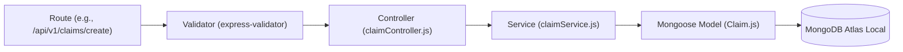

# 06. Backend Documentation

## 1. Overview & Architecture

The **InsureMed** backend is a high-performance REST API built on **Node.js 20** and **Express 5.1.0**. It follows a modular, layered architectural pattern running natively in ECMAScript Modules mode (`"type": "module"`).

The architecture cleanly decouples the transport layer (HTTP routing and controllers) from the business domain layer (services and database models).

---

## 2. Directory Structure

```text
Server/
├── app.js                      # Express application setup, global middleware, & route mounting
├── server.js                   # Server entry point: DB connection & HTTP listener
├── openapi.yaml                # OpenAPI 3.0 specification file for Swagger UI
├── Dockerfile                  # Container build specification (Node 20 Alpine)
├── package.json                # Project dependencies and npm scripts
├── cron/                       # Scheduled background jobs
│   └── escalation.js           # 5-minute cron job for SLA ticket escalation
├── constants/                  # Domain constants and enumerations
│   ├── planTypes.js            # Plan type definitions (individual, family, etc.)
│   ├── roles.js                # Role constants (ADMIN, CUSTOMER, AGENT)
│   └── statusCodes.js          # Status enumerations for claims and policies
├── controllers/                # HTTP request handlers (parameter extraction & responses)
│   ├── adminController.js      # Global search and settings endpoints
│   ├── aiController.js         # Basic AI chat endpoint
│   ├── analyticController.js   # Financial analytics and statistics
│   ├── applicationController.js# Application submission and approval
│   ├── authController.js       # Register, login, logout, verification, password
│   ├── chat.controller.js      # Advanced RAG policy chat with citations
│   ├── claimController.js      # Claim submission, review, and status updates
│   ├── dashboardController.js  # Customer and admin dashboard metrics
│   ├── faqController.js        # FAQ retrieval and management
│   ├── notificationController.js# Notification retrieval and mark-as-read
│   ├── planController.js       # Plan CRUD and risk score calculation
│   ├── policyController.js     # Policy queries, renewals, cancellations
│   ├── settingController.js    # System configuration settings
│   ├── ticketController.js     # Support ticket creation, reply, assignment
│   └── userController.js       # User profile and admin user administration
├── middlewares/                # Express middleware pipeline
│   ├── bruteForce.js           # Account lockout protection
│   ├── csrf.js                 # CSRF protection logic
│   ├── errorHandler.js         # Centralized error handling pipeline
│   ├── protect.js              # JWT verification and role restriction
│   ├── rateLimit.js            # Redis-backed rate limiting
│   ├── upload.js               # Multer multipart file upload handler
│   └── validateMiddleware.js   # express-validator result inspector
├── models/                     # Mongoose schema definitions (10 models)
├── routes/                     # Route definitions (URL mapping and middleware chaining)
├── scripts/                    # Maintenance and migration scripts
│   ├── check-models.js         # Mongoose schema integrity checker
│   └── ingest-document.js      # Document chunking and vector ingestion CLI
├── seed/                       # Database seeding scripts
│   └── createAdmin.js          # Admin account generator
├── seed.js                     # FAQ and vector embedding database seeder
├── services/                   # Business logic and database access layer
│   ├── adminService.js         # Administrative operations logic
│   ├── aiService.js            # Direct Gemini generation service
│   ├── analyticService.js      # Revenue aggregation and reporting
│   ├── applicationService.js   # Application lifecycle logic
│   ├── authService.js          # Token issuance, hashing, user management
│   ├── claimService.js         # Claim validation and state transitions
│   ├── dashboardService.js     # Aggregate queries for dashboard cards
│   ├── embedding.service.js    # Gemini batch embedding generation
│   ├── notificationService.js  # Notification creation and email dispatch
│   ├── PlanService.js          # Insurance plan business logic
│   ├── policyService.js        # Policy generation, snapshotting, renewals
│   ├── rag.service.js          # Vector search query pipeline
│   ├── settingService.js       # System settings cache and updates
│   ├── ticketService.js        # Ticket creation, reply, SLA deadlines
│   └── userService.js          # User record updates
├── tests/                      # Automated test suite
│   └── ticketOwnership.test.js # Node.js test runner unit and integration tests
├── utils/                      # Helper utilities
│   ├── AppError.js             # Custom operational error class
│   ├── hashToken.js            # SHA-256 token hashing for resets
│   └── sendEmail.js            # Nodemailer client with bypass support
└── validators/                 # express-validator rule chains
```

---

## 3. Application Lifecycle & Startup

### Startup Sequencing (`Server/server.js`)
1. **Environment Initialization:** Loads `.env` using `dotenv.config()`.
2. **Database Connection:** Invokes `mongoose.connect(process.env.MONGODB_URI)`.
   - Logs `✅ MongoDB connected` upon success.
   - Logs errors and exits if connection fails.
3. **HTTP Server Activation:** Starts listening on `PORT` (defaults to `3001`):
   ```javascript
   const PORT = process.env.PORT || 3001;
   app.listen(PORT, () => console.log(`🚀 Server running on port ${PORT}`));
   ```

### Express Application Pipeline (`Server/app.js`)
1. **Background Schedulers:** Imports `./cron/escalation.js` to register cron tasks.
2. **OpenAPI / Swagger Loading:** Synchronously reads `openapi.yaml` via `js-yaml` and serves the Swagger UI at `/api-docs`.
3. **Core Middlewares:**
   - `express.json()`: Parses incoming JSON bodies.
   - `cookieParser()`: Extracts cookies for JWT session validation.
   - `cors()`: Handles cross-origin headers with `credentials: true`.
   - `express.static("/uploads")`: Serves uploaded policy documents and claim receipts.
4. **API Route Registration:** Mounts modular routers under `/api/v1/`.
5. **404 Catch-All:** Forwards unmatched routes to `AppError("Cannot find ...", 404)`.
6. **Global Error Handler:** Catches all rejected promises and errors.

---

## 4. Middleware Stack

| Middleware | File | Purpose |
| :--- | :--- | :--- |
| **`protect`** | `middlewares/protect.js` | Authenticates requests by reading the JWT from either the `Authorization: Bearer <token>` header or `jwt` / `token` cookies. Verifies the token signature, checks if the user still exists, and confirms the user hasn't changed their password since token issuance. Attaches `req.user` to the request. |
| **`restrictTo`** | `middlewares/protect.js` | Higher-order role authorization middleware (e.g., `restrictTo('admin', 'agent')`). Compares `req.user.role` against authorized roles and throws a 403 Forbidden error on mismatch. |
| **`authLimiter`** | `middlewares/rateLimit.js` | Rate limits sensitive endpoints (login, register) using Redis. Allows 5 requests per 15-minute window per IP. |
| **`upload`** | `middlewares/upload.js` | Configures **Multer** disk storage for handling file uploads (`multipart/form-data`) into `Server/uploads/`. |
| **`validate`** | `middlewares/validateMiddleware.js` | Checks `express-validator` validation results. If errors exist, halts the request and returns a `400 Bad Request` containing an array of field-level validation errors. |
| **`globalErrorHandler`** | `middlewares/errorHandler.js` | Centralized Express error handler. Formats clean, operational JSON errors for clients while logging stack traces in development. |

---

## 5. Layered Architecture: Controller vs. Service Pattern

InsureMed enforces strict separation between transport logic and business logic:



### 1. Controllers (`Server/controllers/`)
Controllers are thin adapters. They:
- Extract parameters from `req.body`, `req.params`, `req.query`, and `req.file`.
- Pass arguments to the corresponding service method.
- Return HTTP status codes (`200`, `201`, `204`) with standardized JSON envelopes:
  ```json
  {
    "status": "success",
    "data": { ... }
  }
  ```

### 2. Services (`Server/services/`)
Services contain the core domain logic:
- Validate domain invariants (e.g., verifying a user owns the policy they are filing a claim against).
- Execute Mongoose queries and aggregation pipelines.
- Trigger side effects (e.g., generating notifications or sending transactional emails).
- Throw descriptive `AppError` instances when operations fail.

---

## 6. Error Handling Strategy

Errors are handled centrally via the `AppError` class (`Server/utils/AppError.js`) and `globalErrorHandler` (`Server/middlewares/errorHandler.js`).

### Operational vs. Programming Errors
- **Operational Errors (`isOperational = true`):** Predictable failures (e.g., invalid user input, expired tokens, resource not found). These return clean, user-friendly JSON messages.
- **Programming Errors (`isOperational = false`):** Unexpected bugs or system failures. In production, these return a generic `500 Internal Server Error` to prevent leaking internal system architecture.

### Automatic Error Transformations
The global error handler intercepts and normalizes common database and library errors:
- **`CastError` (Invalid MongoDB ObjectId):** Converted to `400 Bad Request: Invalid ID format`.
- **`ValidationError` (Mongoose Schema Validation):** Aggregates field errors into a single readable message.
- **`11000 Duplicate Key Error`:** Extracts the duplicate field and returns `400 Bad Request: Value already in use`.
- **`JsonWebTokenError` / `TokenExpiredError`:** Converted to `401 Unauthorized: Invalid or expired token`.

---

## 7. Background Jobs: SLA Escalation Scheduler

The ticket SLA escalation engine runs as an in-process cron worker (`Server/cron/escalation.js`):

```javascript
import cron from "node-cron";
import Ticket from "../models/ticket.js";
import sendEmail from "../utils/sendEmail.js";

// Schedules execution every 5 minutes
cron.schedule("*/5 * * * *", async () => {
  const now = new Date();
  const oneHourFromNow = new Date(now.getTime() + 60 * 60 * 1000);

  // Phase 1: Warning check (T-1 Hour before deadline)
  const warningTickets = await Ticket.find({
    status: { $in: ["OPEN", "IN_REVIEW"] },
    warningSent: false,
    isEscalated: false,
    slaDeadline: { $gt: now, $lt: oneHourFromNow },
  }).populate("assignedTo user");

  for (const ticket of warningTickets) {
    ticket.warningSent = true;
    await ticket.save();
    if (ticket.assignedTo?.email) {
      await sendEmail({
        email: ticket.assignedTo.email,
        subject: `⚠️ WARNING: Ticket ${ticket.ticketId} expires soon`,
        message: `You have less than 1 hour to respond to ticket ${ticket.ticketId}.`,
      });
    }
  }

  // Phase 2: Escalation check (Overdue tickets)
  const overdueTickets = await Ticket.find({
    status: { $in: ["OPEN", "IN_REVIEW"] },
    isEscalated: false,
    slaDeadline: { $lt: now },
  }).populate("user");

  for (const ticket of overdueTickets) {
    ticket.isEscalated = true;
    ticket.priority = "EMERGENCY"; // Force priority upgrade
    await ticket.save();

    await sendEmail({
      email: "jemalfiragos@gmail.com", // Administrator notification recipient
      subject: `🚨 ESCALATION: Ticket ${ticket.ticketId} is overdue!`,
      message: `Ticket ${ticket.ticketId} has exceeded its SLA deadline.`,
    });
  }
});
```

---

## 8. Email Integration & Graceful Bypass

Email delivery is managed by `Server/utils/sendEmail.js` using Nodemailer.

To ensure frictionless development when an external SMTP server is not available, the utility implements an immediate bypass:

```javascript
export default async function sendEmail({ email, subject, message }) {
  if (!process.env.SMTP_HOST) {
    console.log(`[Email Bypass] Email to ${email} skipped (SMTP_HOST not configured).`);
    return { bypassed: true };
  }
  
  const transporter = nodemailer.createTransport({
    host: process.env.SMTP_HOST,
    port: process.env.SMTP_PORT || 587,
    auth: {
      user: process.env.SMTP_USER,
      pass: process.env.SMTP_PASS,
    },
  });

  return await transporter.sendMail({
    from: process.env.SMTP_FROM || "noreply@insuremed.local",
    to: email,
    subject,
    text: message,
  });
}
```

This bypass guarantees that user registration and password reset workflows execute immediately without waiting for SMTP connection timeouts.
