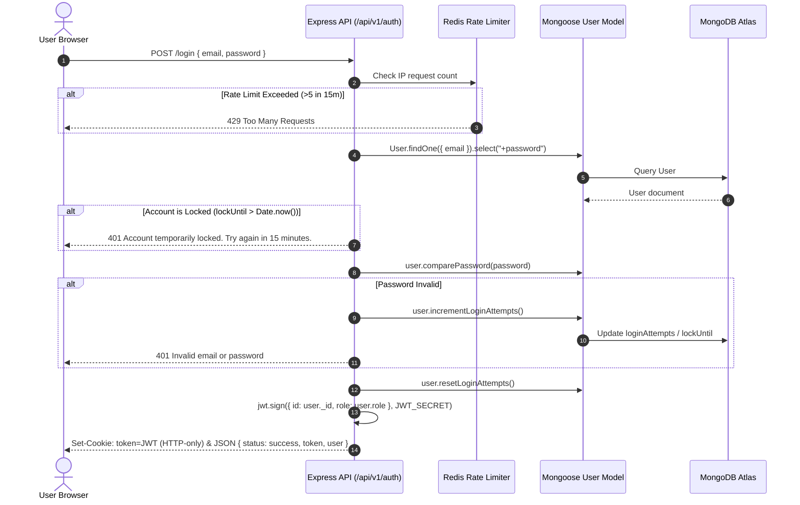
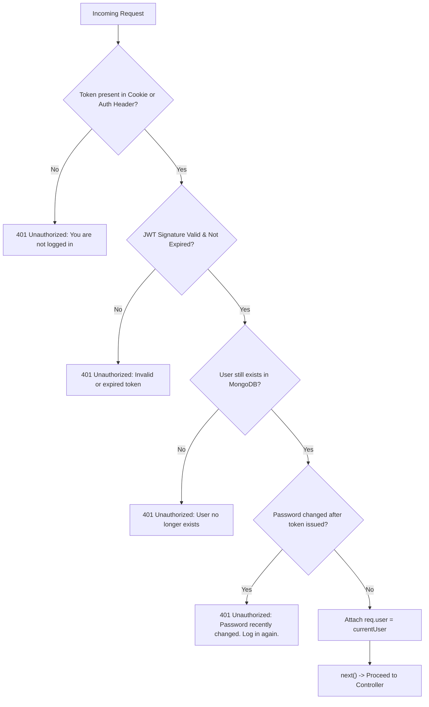

# 09. Authentication and Authorization

InsureMed implements a secure, defense-in-depth authentication and authorization architecture combining salted password hashing, signed JSON Web Tokens (JWT), cookie and header session transport, brute-force account lockout defenses, and granular Role-Based Access Control (RBAC).

---

## 1. Authentication Lifecycle



---

## 2. Password Handling & Cryptographic Security

### Hashing Strategy (`Server/models/user.js`)
Passwords are never stored in plaintext. Mongoose pre-save hooks automatically hash passwords using **Bcrypt** with **10 salt rounds**:

```javascript
userSchema.pre("save", async function (next) {
  if (!this.isModified("password")) return next();
  const salt = await bcrypt.genSalt(10);
  this.password = await bcrypt.hash(this.password, salt);
  this.passwordConfirm = undefined; // Strips confirmation field from persistence
  next();
});
```

### Password Confirmation Validation
Registration and password change schemas enforce strict confirmation checks in memory before hashing:
```javascript
passwordConfirm: {
  type: String,
  required: function () { return this.isNew; },
  validate: {
    validator: function (val) { return this.password === val; },
    message: "Passwords do not match!",
  },
  select: false,
}
```

### Verification & Comparison
The schema provides an instance method for constant-time comparison during login:
```javascript
userSchema.methods.comparePassword = function (candidate) {
  return bcrypt.compare(candidate, this.password);
};
```

---

## 3. JSON Web Token (JWT) Implementation

### Token Generation (`Server/services/authService.js`)
Upon successful authentication, the server generates a cryptographically signed JWT:
- **Payload:** `{ id: user._id, role: user.role }`
- **Signing Secret:** Loaded from `process.env.JWT_SECRET`
- **Expiration:** Configured via `JWT_EXPIRES_IN` (defaults to 7 days or 24 hours)

### Dual-Transport Session Architecture
To support web browsers, mobile clients, and developer tools seamlessly, InsureMed accepts tokens via two channels:
1. **HTTP-Only Cookies:** The server issues a `Set-Cookie: jwt=...; HttpOnly; SameSite=Lax` header, protecting tokens from cross-site scripting (XSS) extraction in web browsers.
2. **Authorization Headers:** Clients can also pass tokens explicitly via `Authorization: Bearer <token>`, enabling testing via Swagger, curl, and automated scripts.

---

## 4. Authentication Middleware (`protect.js`)

Protected routes chain the `protect` middleware (`Server/middlewares/protect.js`). The validation pipeline performs the following checks:



---

## 5. Role-Based Authorization (`restrictTo.js`)

Authorization permissions are decoupled into three standardized system roles:
- **`customer`:** Policyholders with access only to their own policies, claims, and applications.
- **`admin`:** Full administrative authority over plans, underwriting, claim approvals, settings, and user accounts.
- **`agent`:** Support staff permitted to review and reply to customer tickets.

### Middleware Implementation
```javascript
export const restrictTo = (...roles) => {
  return (req, res, next) => {
    if (!roles.includes(req.user.role)) {
      return next(
        new AppError("You do not have permission to perform this action", 403)
      );
    }
    next();
  };
};
```

---

## 6. Account Security & Attack Defenses

### Brute-Force Lockout Defense
To mitigate automated credential-stuffing and password dictionary attacks:
- The `User` model tracks `loginAttempts` (integer) and `lockUntil` (timestamp).
- If **5 consecutive failed login attempts** occur, the account is automatically locked for **15 minutes**:
  ```javascript
  userSchema.methods.incrementLoginAttempts = async function (maxAttempts = 5, lockTimeMs = 15 * 60 * 1000) {
    this.loginAttempts = (this.loginAttempts || 0) + 1;
    if (this.loginAttempts >= maxAttempts) {
      this.lockUntil = new Date(Date.now() + lockTimeMs);
    }
    return this.save();
  };
  ```
- Any login attempts while `lockUntil > Date.now()` are rejected immediately with a 401 error.
- A successful login automatically invokes `resetLoginAttempts()`, clearing counters.

### Cryptographic Reset & Verification Tokens
- **Password Reset:** Generates a 20-byte random hex token (`crypto.randomBytes(20)`). The unhashed token is emailed to the user, while a SHA-256 hash (`hashToken(token)`) is saved to `resetPasswordToken` with a 10-minute expiration.
- **Email Verification:** Generates a 32-byte hex token stored as a SHA-256 hash with a 24-hour expiration (`EMAIL_VERIFY_EXPIRES_MINUTES`).

---

## 7. Role Permission Comparison

| Capability | Customer (`customer`) | Agent (`agent`) | Administrator (`admin`) |
| :--- | :---: | :---: | :---: |
| Browse Published Plans | Yes | Yes | Yes |
| Apply for Insurance Policy | Yes | No | No |
| View Own Policies & Claims | Yes | Yes | Yes |
| Submit Claims with Receipts | Yes | No | No |
| Create Support Tickets | Yes | No | Yes |
| View All Customer Support Tickets | No | Yes | Yes |
| Reply to Assigned Tickets | Own Only | Yes | Yes |
| Assign Tickets to Staff | No | No | Yes |
| Approve / Reject Claims | No | No | Yes |
| Approve / Reject Policy Applications | No | No | Yes |
| Create, Edit, or Delete Insurance Plans | No | No | Yes |
| Preview Underwriting Risk Scores | No | No | Yes |
| Modify Global System Settings | No | No | Yes |
| Update User Roles & Access | No | No | Yes |
| View Financial Revenue Analytics | No | No | Yes |
