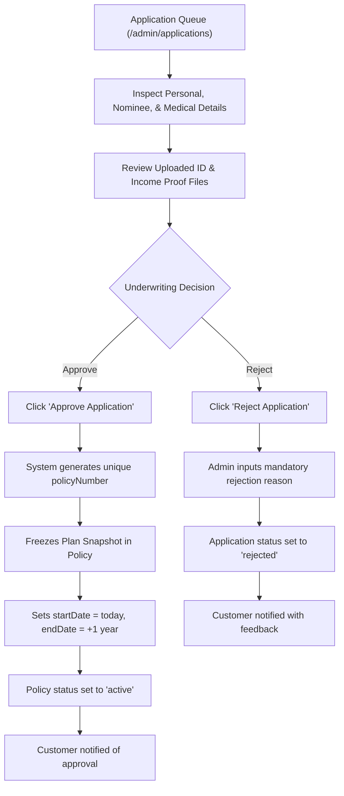

# 11. Administrator Guide

The **InsureMed Administrative Portal** provides insurance underwriters, claims adjudicators, customer support leads, and system administrators with a unified operations console.

This guide details all verified administrative workflows, underwriting controls, and operational settings.

---

## 1. Access & Initial Administrator Setup

### Administrator Account Provisioning
The primary system administrator account is created using the containerized seed utility:

```bash
docker compose exec server node seed/createAdmin.js
```

- The script reads `ADMIN_EMAIL` and `ADMIN_PASSWORD` securely from `Server/.env`.
- It verifies whether an administrator with that email already exists before inserting.
- The password is salted and hashed using bcrypt before writing to MongoDB with `role: "admin"`.

### Logging In
1. Navigate to [http://localhost:3000/auth](http://localhost:3000/auth).
2. Enter your administrative email and password.
3. Upon authentication, you will be automatically redirected to the **Admin Portal** at [http://localhost:3000/admin/dashboard](http://localhost:3000/admin/dashboard).

---

## 2. Administrator Dashboard & Analytics (`/admin/dashboard`)

The executive dashboard provides a macro overview of business and operational metrics:

- **Executive KPI Cards:**
  - **Total Earned Revenue:** Sum of all collected policy premiums.
  - **Total Claims Disbursed:** Total monetary amount approved and paid out for claims.
  - **Active Insured Members:** Total count of active policies currently in effect.
  - **Claim Approval Ratio:** Percentage of processed claims that were approved.
- **Financial & Claim Trend Visualizations:**
  - Interactive Recharts bar/line graphs displaying monthly premium intake vs. monthly claims expenditure.
- **Action Required Feeds:**
  - Quick-view lists of pending applications awaiting underwriting review, pending claims awaiting adjudication, and unresolved emergency support tickets.

---

## 3. Plan Management (`/admin/all-plans` & `/admin/create/plan`)

Administrators control the health insurance catalog and underwriting rules:

### Creating a New Insurance Plan (`/admin/create/plan`)
1. **Basic Details:** Specify the plan title, plan type (`Individual`, `Family`, `Senior`, `Student`, `Corporate`), category, and validity period (default: 365 days).
2. **Pricing & Deductibles:**
   - **Premium Rate:** Dollar amount per payment frequency.
   - **Payment Frequency:** Billing cadence (`Monthly`, `Quarterly`, `Annually`).
   - **Coverage Limit:** Maximum annual benefit payout ceiling (e.g., `$500,000`).
   - **Deductible:** Annual out-of-pocket amount required from the member before coverage begins (default: `$500`).
3. **Underwriting Constraints:**
   - Minimum and maximum eligible applicant ages (e.g., 18 to 65).
   - Maximum covered family members (e.g., 1 for individual, up to 6 for family plans).
   - Network hospital size (e.g., `1000+ accredited facilities`).
   - Mandatory waiting periods (e.g., `30 days` for pre-existing conditions).
4. **Features & Exclusions:**
   - Define highlighted benefits (e.g., *Full emergency ambulance coverage*, *Annual preventive wellness checkup*).
   - Enumerate explicit non-covered treatments (e.g., *Cosmetic surgery*, *Experimental alternative therapies*).
5. **Underwriting Risk Score Preview (`POST /api/v1/plans/risk-score`):**
   - Click **Preview Risk Score** prior to publishing.
   - The system evaluates the proposed premium, coverage ceiling, deductible, and applicant age brackets to return a risk score (0 to 100) and actionable actuarial recommendations.
6. Click **Save & Publish Plan** to make it available in the public catalog.

### Editing & Soft-Deleting Plans
- In the plan listing (`/admin/all-plans`), administrators can modify terms or click **Archive/Delete** to soft-delete a plan (`isDeleted = true`). Existing active policies under an archived plan remain unaffected.

---

## 4. Policy Application Underwriting (`/admin/applications`)

Every digital application submitted by a customer enters the administrative underwriting queue:



### Steps to Adjudicate an Application:
1. Navigate to **Applications** (`/admin/applications`).
2. Filter by status: `pending`, `approved`, or `rejected`.
3. Click on any application to open the **Underwriting Inspector**:
   - Verify the applicant's contact details, age eligibility, and beneficiary nominee.
   - Review the applicant's disclosed medical history and pre-existing conditions.
   - Click document links to inspect attached identification and income verification files.
4. **To Approve:**
   - Click **Approve Application**.
   - The backend creates a new `Policy` document, assigns a unique policy number (e.g., `POL-2026-9812`), freezes the plan terms into `planSnapshot`, sets dates for a 365-day term, and marks the application `approved`.
5. **To Reject:**
   - Click **Reject Application**.
   - Input the required explanation (e.g., *"Medical history disclosure incomplete; missing physician clearance report"*).
   - The application transitions to `rejected`, and the explanation is recorded in the customer's portal.

---

## 5. Policy Lifecycle & Renewal Management (`/admin/all-policies`)

Administrators monitor active coverage and handle contract modifications:

- **Policy Inspection (`/admin/policies/details`):**
  - View the immutable `planSnapshot` recorded at the time of purchase.
  - Review historical payment records, renewal counts, and coverage expiration dates.
- **Approving Renewal Requests:**
  - When a customer requests renewal, the policy status changes to `pending_renewal`.
  - The administrator verifies the renewal payment transaction reference.
  - Click **Approve Renewal**: The backend extends the policy `endDate` by 365 days, increments `renewalCount`, and restores status to `active`.
- **Policy Cancellation:**
  - If a member defaults or requests early termination, administrators can cancel a policy via `PUT /api/v1/policies/:id/cancel` with an audit reason.

---

## 6. Claims Adjudication (`/admin/all-claims`)

Administrators evaluate reimbursement claims submitted by policyholders:

1. Navigate to **Claims Management** (`/admin/all-claims`).
2. The claims queue displays:
   - Claim ID, Filer Name, Policy Number, Claimed Monetary Amount, Claim Type, and Filing Date.
3. Open a claim to inspect details:
   - Verify that the treatment date falls within the policy's effective coverage period (`startDate` to `endDate`).
   - Inspect the attached medical bill, pharmacy receipt, or hospital discharge summary.
   - Verify that the claimed amount does not exceed the policy's remaining coverage limit.
4. **Adjudication Decisions:**
   - **Approve Claim:** Sets status to `Approved`. Records the `reviewedAt` timestamp and admin ID. Authorizes financial reimbursement.
   - **Reject Claim:** Sets status to `Rejected`. Logs the justification for the policyholder's record.

---

## 7. Support Ticket & SLA Management (`/admin/support/tickets`)

The support console enables staff to coordinate customer inquiries:

- **Ticket Queue:**
  - Lists all open, in-review, and escalated tickets across the platform.
  - Highlights priority levels (`LOW`, `MEDIUM`, `HIGH`, `EMERGENCY`) and displays real-time countdowns to the SLA deadline.
- **Assigning Tickets:**
  - Administrators can assign tickets to specific support agents or underwriters (`PATCH /api/v1/support/tickets/:id/assign`).
- **Live Ticket Messaging (`/admin/tickets/:id`):**
  - Read customer messages and send threaded responses.
  - Update ticket statuses (`OPEN`, `IN_REVIEW`, `WAITING`, `RESOLVED`, `CLOSED`).
- **FAQ Management:**
  - Create and edit system FAQs (`/faqs`) that appear in customer self-service search.

---

## 8. User Management (`/admin/users`)

Administrators can inspect and manage all registered user accounts:

- **User Roster:**
  - Lists users with full name, email, membership tier, creation date, and current role.
- **Role Assignment:**
  - Elevate customer accounts to `agent` or `admin` status.
- **Account Moderation:**
  - Suspend or deactivate compromised user accounts.
  - Inspect consecutive failed login attempts and unlock temporarily locked accounts if necessary.

---

## 9. Global System Settings (`/admin/settings`)

The settings panel controls platform-wide operational configurations:

| Setting Parameter | Default Value | Description |
| :--- | :--- | :--- |
| **System Branding Name** | `InsuTrack Pro` | Application name displayed in reports and email footers. |
| **Contact Support Email** | `admin@insutrack.com` | Official support address displayed to customers. |
| **Base Currency** | `USD` | Monetary currency code used for premiums and claims. |
| **Global Premium Tax Rate**| `15%` | Tax percentage automatically appended to policy quotes. |
| **Renewal Grace Period** | `30 days` | Days after policy expiration during which customers can renew without underwriting re-examination. |
| **Maintenance Mode** | `false` | System-wide toggle to temporarily disable public applications and claim filing during maintenance windows. |
| **Auto-Approve Claims Under**| `0` (Manual only) | Configurable monetary threshold under which valid claims automatically approve. |
