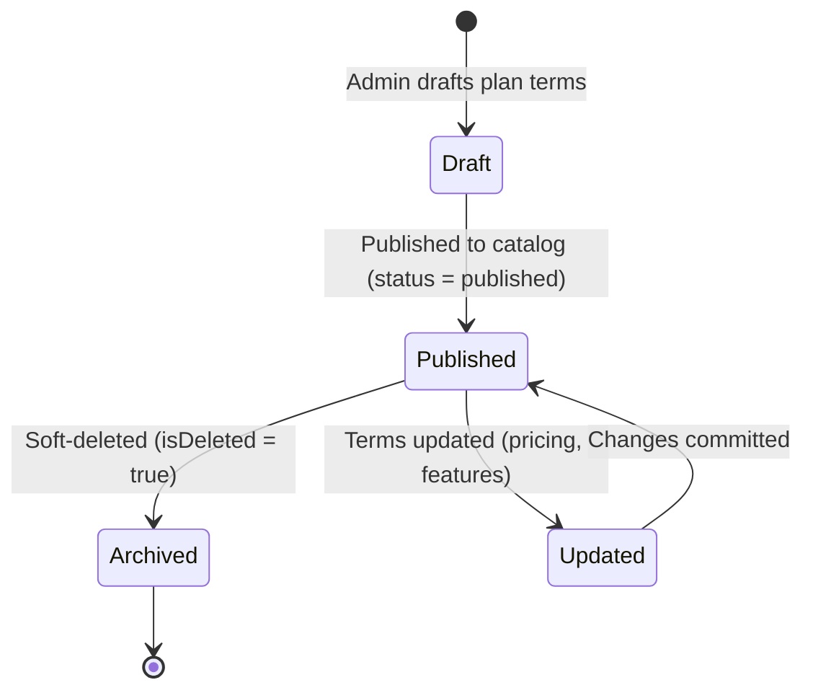
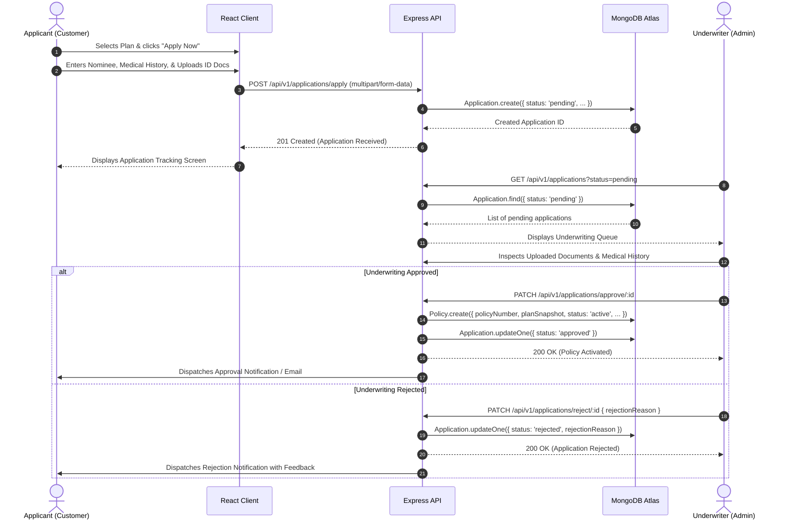
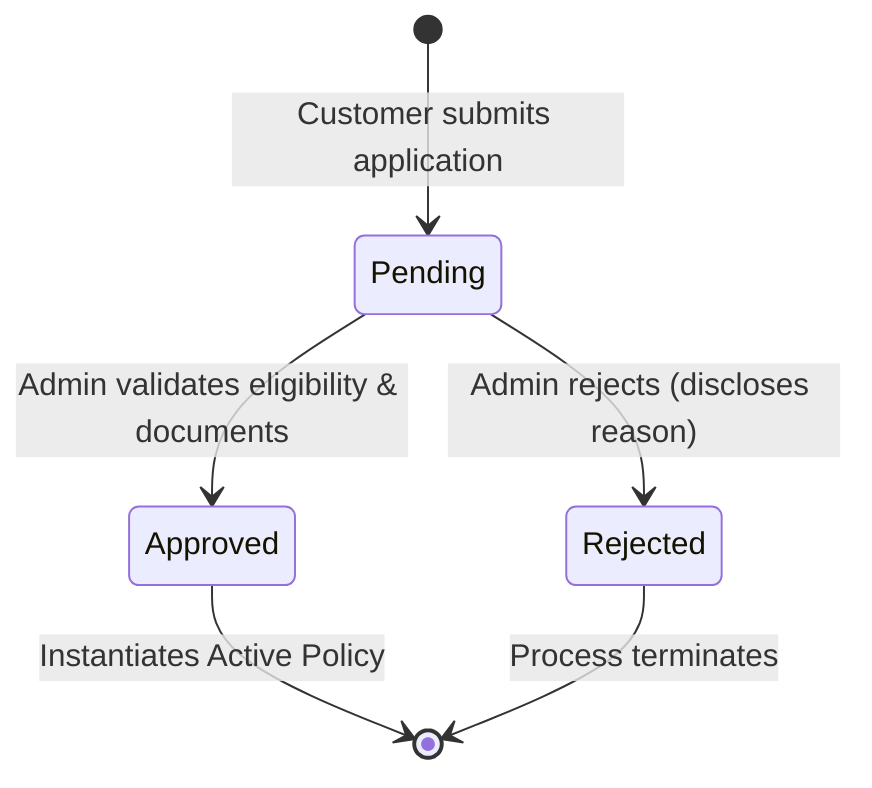
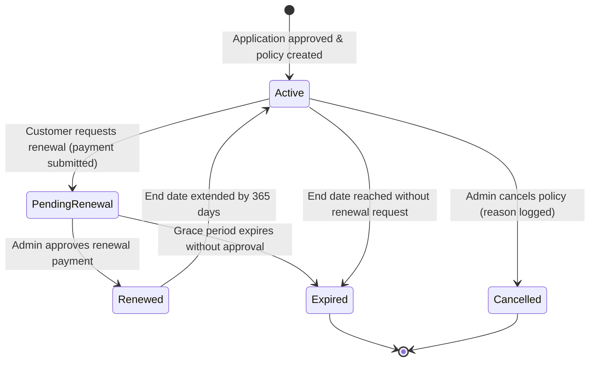

# 12. Insurance Business Workflows

This document models the complete lifecycle of insurance operations within **InsureMed**, from initial plan creation to application underwriting, policy activation, renewal cycles, and contract termination.

---

## 1. Plan Management Lifecycle

Insurance plans represent product offerings created by insurance administrators.



### Plan State Matrix
| State | Visible to Public? | Can Accept New Applications? | Impact on Existing Policies |
| :--- | :---: | :---: | :--- |
| **`draft`** | No | No | None. Plan is being drafted. |
| **`published`** | Yes | Yes | Active policies continue referencing their original snapshot. |
| **`archived` / `isDeleted: true`** | No | No | Soft-deleted. Existing issued policies remain fully active until their expiration dates. |

---

## 2. Policy Application & Underwriting Workflow

The policy onboarding pipeline connects an uninsured applicant to an active legal policy:



### Application State Transitions



| From State | To State | Trigger | Required Preconditions | Actions Taken by System |
| :--- | :--- | :--- | :--- | :--- |
| **`[*]"`** | `pending` | Customer submission | Plan is published; required personal, nominee, and medical fields populated; ID document uploaded. | Saves application record; stores uploaded files in `/uploads/`; creates customer confirmation notification. |
| `pending` | `approved` | Administrative approval | Verification of identity and acceptable underwriting risk. | Generates unique `policyNumber` (e.g., `POL-2026-XXXX`); captures immutable `planSnapshot`; sets `startDate = today`, `endDate = today + 365 days`; creates active `Policy` document. |
| `pending` | `rejected` | Administrative rejection | Incomplete paperwork, excessive risk, or false disclosures. | Records mandatory `rejectionReason`; updates status to `rejected`; notifies applicant. |

---

## 3. Policy Contract Lifecycle

Once an application is approved, an active policy contract is instantiated. The policy transitions through several states over its lifecycle:



### Detailed Policy State Machine

| Policy Status | Description | Coverage In Effect? | Eligible for Claims? | Allowed Transitions |
| :--- | :--- | :---: | :---: | :--- |
| **`active`** | The policy is legally binding and in good standing. | **Yes** | **Yes** | `pending_renewal`, `expired`, `cancelled` |
| **`pending_renewal`** | The policyholder requested a policy renewal and submitted payment details. Coverage continues during administrative verification. | **Yes** | **Yes** | `renewed`, `expired`, `cancelled` |
| **`renewed`** | Administrative approval of renewal verified. The backend extends `endDate` by 365 days, increments `renewalCount`, and returns status to `active`. | **Yes** | **Yes** | `active` |
| **`expired`** | Policy reached its `endDate` and exceeded the 30-day grace period without a successful renewal. | **No** | **No** | None (Archived) |
| **`cancelled`** | Terminated prematurely by administration upon customer request or non-compliance. Cancellation timestamp and reason are logged. | **No** | **No** | None (Terminated) |

---

## 4. Policy Renewal Deep Dive

InsureMed supports policy renewals without requiring policyholders to restart the full underwriting and application process.

### Renewal Execution Flow:
1. **Customer Trigger:** Within 30 days prior to or following `endDate` (the configurable `renewalGracePeriod` in `Setting`), the customer clicks **Request Renewal** on their dashboard.
2. **Payment Documentation:** The customer selects a payment channel (e.g., `Bank Transfer`) and submits the transaction reference.
3. **Pending Verification:** Policy status updates to `pending_renewal`.
4. **Administrative Verification:** The underwriter navigates to `/admin/all-policies`, filters by `pending_renewal`, checks the transaction receipt, and clicks **Approve Renewal**.
5. **Contract Extension:**
   - The backend extends `endDate` by exactly 1 year (365 days):
     ```javascript
     policy.endDate = new Date(policy.endDate.getTime() + 365 * 24 * 60 * 60 * 1000);
     policy.renewalCount += 1;
     policy.lastRenewedAt = new Date();
     policy.status = "active";
     await policy.save();
     ```
   - Continuous coverage is preserved without gap.

---

## 5. Policy Snapshotting Architecture

A critical insurance requirement implemented in InsureMed is **Plan Snapshotting**.

When an insurance plan is updated (e.g., the insurance company raises premiums or adjusts deductible ceilings for next year's market), existing active policyholders must remain under the contract terms they originally agreed to.

When an application is approved, InsureMed freezes the current plan terms inside the policy's `planSnapshot` object:

```javascript
planSnapshot: {
  name: plan.name,
  coverageAmount: plan.coverageAmount,
  planType: plan.planType,
  deductible: plan.deductible,
  premium: plan.premium,
}
```

Future modifications to the parent `Plan` document in MongoDB do not mutate the terms of already-issued policies.
