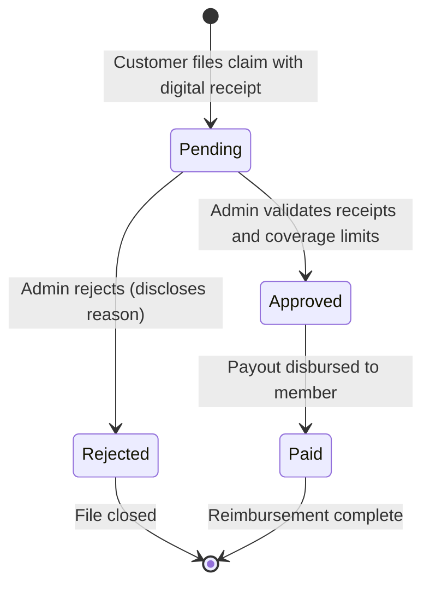
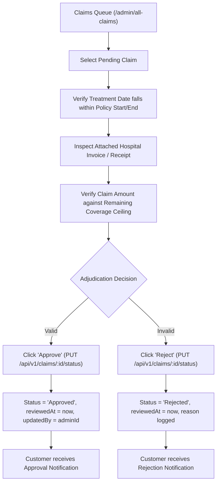

# 13. Claims Management

The claims adjudication module is the financial core of **InsureMed**. It enables policyholders to submit medical reimbursement claims with digital invoices and provides insurance administrators with underwriting tools to review, approve, or reject claims.

---

## 1. Claim Adjudication Lifecycle

### Claim State Matrix
| Status Code | Description | Next Allowed State | Can Customer Resubmit? |
| :--- | :--- | :--- | :---: |
| **`Pending`** | Claim received and placed in the administrative review queue. Awaiting review by an insurance claims adjuster. | `Approved`, `Rejected` | N/A |
| **`Approved`** | Claim validated and authorized. Medical expenses confirmed as covered under policy terms. | `Paid` | No |
| **`Rejected`** | Claim denied. Justification recorded (e.g., treatment not covered, receipt illegible, incident preceded policy start date). | Closed | Yes (New Claim) |

---

## 2. Customer Claim Submission Process

### Required Information
When filing a claim via `POST /api/v1/claims/create` (`/dashboard/claims/new`), the policyholder provides:

1. **Policy Reference (`policyNumber`):** The unique policy identifier under which coverage is claimed.
2. **Claim Classification (`claimType`):** Category of medical service (e.g., `Hospitalization`, `Outpatient Specialist`, `Diagnostic Testing`, `Pharmacy / Medication`).
3. **Claim Amount (`amount`):** The exact numerical out-of-pocket dollar amount requested for reimbursement.
4. **Treatment Summary / Incident Reason (`reason`):** Text description summarizing the illness, diagnosis, or emergency event.
5. **Documentary Proof (`document`):** A digital receipt, bill, or hospital discharge summary uploaded as a file attachment (`multipart/form-data`). Supported formats: `.pdf`, `.png`, `.jpg`.

### Server-Side Validation Rules (`Server/validators/claimValidator.js`)
Before creating the claim record, the backend validates:
- **Ownership Verification:** The authenticated user (`req.user.id`) must own the referenced policy.
- **Contract Standing:** The policy must be in `active` or `pending_renewal` status. Claims filed against `expired` or `cancelled` policies are rejected immediately.
- **Amount Boundary:** `amount` must be a positive number greater than `0`.
- **Mandatory Attachment:** A valid file attachment must be parsed by Multer and stored in `/uploads/`.

---

## 3. Administrative Adjudication Workflow

Insurance claims adjusters manage the claims queue via `/admin/all-claims`:

### Key Adjudication Checkpoints:
1. **Effective Dates Check:** The date of service must fall between `policy.startDate` and `policy.endDate`.
2. **Exclusion Check:** The diagnosis must not match the explicit `exclusions` array saved in the policy's plan snapshot.
3. **Receipt Legibility:** The digital document must clearly display the healthcare provider name, patient name, date of service, itemized procedures, and total billed amount.
4. **Coverage Ceiling:** The claim amount, added to prior approved claims for this policy year, must not exceed `planSnapshot.coverageAmount`.

---

## 4. Automated Claims Approval (`autoApproveClaimsUnder`)

InsureMed supports an automated approval setting configured in the `Setting` model (`Server/models/setting.js`):

- **Field:** `autoApproveClaimsUnder` (Number, default `0`).
- **Functionality:** When set to a positive dollar value (e.g., `$100`), incoming claims with valid attachments whose requested amount falls below this threshold automatically transition to `Approved` upon submission, bypassing manual queue bottlenecks for small routine pharmacy or lab expenses.
- When set to `0`, all claims require manual administrative review.

---

## 5. Related API Endpoints

| Method | Endpoint | Access | Purpose |
| :--- | :--- | :--- | :--- |
| `POST` | `/api/v1/claims/create` | Customer | Submits a new claim with file attachment. |
| `GET` | `/api/v1/claims/me` | Customer | Lists all claims filed by the authenticated customer. |
| `GET` | `/api/v1/claims/:id` | Customer / Admin | Retrieves claim detail by ID. |
| `GET` | `/api/v1/claims` | Admin | Lists all claims across all users with pagination and search. |
| `PUT` | `/api/v1/claims/:id/status` | Admin | Updates claim status to `Approved` or `Rejected`. |
| `DELETE` | `/api/v1/claims/:id` | Admin | Soft-deletes a claim (`isDeleted = true`). |
