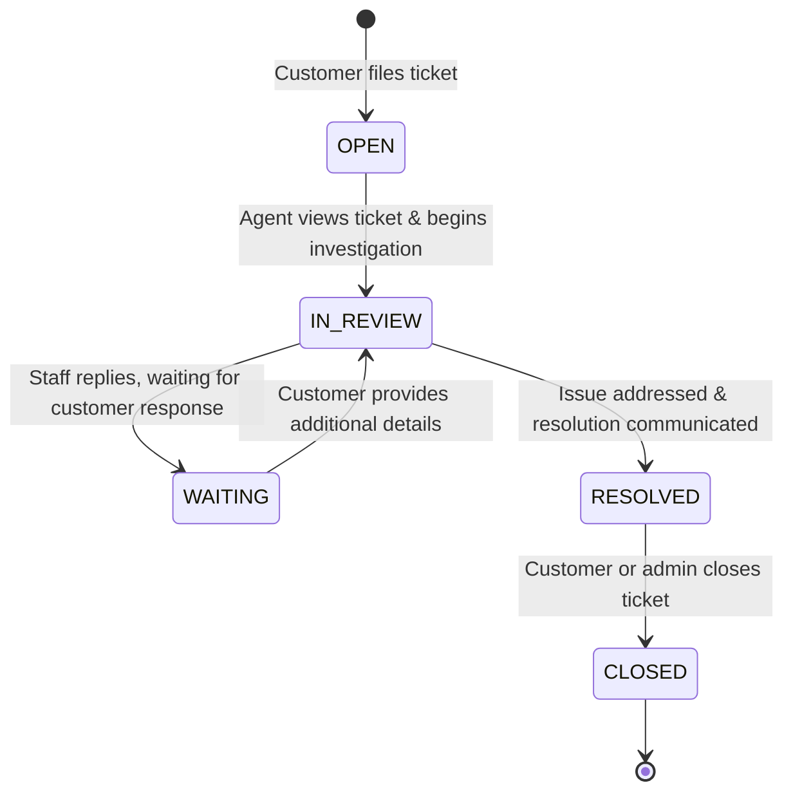
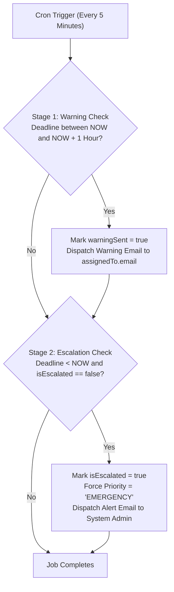

# 14. Support and Notifications

This document describes the customer support ticketing platform, Service Level Agreement (SLA) deadline enforcement, background cron escalation worker, and notification delivery mechanisms within **InsureMed**.

---

## 1. Support Ticketing Architecture

InsureMed includes a customer support module that enables structured, auditable communication between policyholders and insurance staff.



### Ticket Metadata & Classifications

- **Identifier:** Unique, human-readable ticket code auto-generated via Mongoose pre-save hook (e.g., `TIC-492104`):
  ```javascript
  ticketSchema.pre("save", async function (next) {
    if (!this.ticketId) {
      this.ticketId = `TIC-${Math.floor(100000 + Math.random() * 900000)}`;
    }
    next();
  });
  ```
- **Categories:**
  - `CLAIM`: Disputes or inquiries regarding submitted reimbursement claims.
  - `PAYMENT`: Premium billing questions or renewal payment issues.
  - `POLICY`: Coverage inquiries, terms clarification, or endorsements.
  - `ACCOUNT`: Profile updates, login difficulties, or credential changes.
- **Priorities & Resolution SLA Targets:**
  - `LOW`: General inquiries (Resolution SLA: 48 Hours).
  - `MEDIUM`: Standard operational requests (Resolution SLA: 24 Hours).
  - `HIGH`: Urgent claim disputes or hospital admission questions (Resolution SLA: 12 Hours).
  - `EMERGENCY`: Critical hospitalization coverage disputes (Resolution SLA: 4 Hours).

---

## 2. SLA Escalation Engine (`Server/cron/escalation.js`)

To ensure customer support requests are never abandoned, the backend executes an automated background cron job scheduled with `node-cron`:

- **Execution Cadence:** Runs every 5 minutes (`*/5 * * * *`).
- **Two-Stage Enforcement Logic:**



### Stage 1: The Warning Check (T-Minus 1 Hour)
Queries all open or in-review tickets where:
- `status` is in `['OPEN', 'IN_REVIEW']`
- `warningSent == false` and `isEscalated == false`
- `slaDeadline` falls between current time and current time + 60 minutes (`now < slaDeadline < now + 1h`).

**Action Taken:**
1. Sets `ticket.warningSent = true`.
2. Sends an urgent warning email to the assigned agent (`ticket.assignedTo.email`) warning them that less than 1 hour remains to respond before escalation.

### Stage 2: The Escalation Check (Overdue Tickets)
Queries all active tickets where:
- `status` is in `['OPEN', 'IN_REVIEW']`
- `isEscalated == false`
- `slaDeadline < now` (deadline has passed without resolution).

**Action Taken:**
1. Sets `ticket.isEscalated = true`.
2. Upgrades `ticket.priority = "EMERGENCY"` immediately.
3. Persists changes to MongoDB.
4. Sends an administrative escalation notice via email alerting leadership that the ticket breached its contractual SLA.

---

## 3. In-App Notification System

In-app alerts keep policyholders informed of vital events in real time.

### Notification Attributes (`Server/models/notification.js`)
- `userId`: Targeted recipient.
- `title`: Summary headline (e.g., *"Claim Approved"*).
- `message`: Detailed description with next steps.
- `category`: Classification (`claim`, `policy`, `payment`, `analytics`).
- `priority`: Urgency level (`low`, `medium`, `high`).
- `isRead`: Boolean read tracking flag.
- `metadata`: Contextual key-value payload (e.g., `{ policyNumber: "POL-2026-8912", claimId: "6737..." }`).

### Frontend Synchronization
- The customer navigation bar contains an interactive bell icon displaying the unread notification badge count (`Clients/src/stores/notificationStore.js`).
- The notification center (`/dashboard/notifications`) allows users to read alert details, navigate directly to related claims or policies, and mark alerts as read (`PATCH /api/v1/notifications/:id/read` or `PATCH /api/v1/notifications/read-all`).

---

## 4. Email Service Architecture & SMTP Bypass

Automated email delivery is managed by `Server/utils/sendEmail.js` using Nodemailer.

### Handled Email Types
1. **Account Email Verification:** Sent upon registration when verification tokens are created.
2. **Password Reset Tokens:** Sent with secure, one-time reset links.
3. **SLA Warning Alerts:** Dispatched to support assignees 1 hour before SLA deadline expiration.
4. **SLA Overdue Escalations:** Dispatched to administration when tickets breach deadlines.

### Graceful Fallback Mode
In development environments without access to an external SMTP server, the system automatically engages an immediate bypass:

```javascript
export default async function sendEmail({ email, subject, message }) {
  if (!process.env.SMTP_HOST) {
    console.log(`[Email Bypass] Email to ${email} skipped (SMTP_HOST not configured).`);
    return { bypassed: true };
  }
  // Standard Nodemailer transport logic follows...
}
```

This bypass ensures that user registration and password reset workflows execute immediately without waiting for SMTP connection timeouts.
