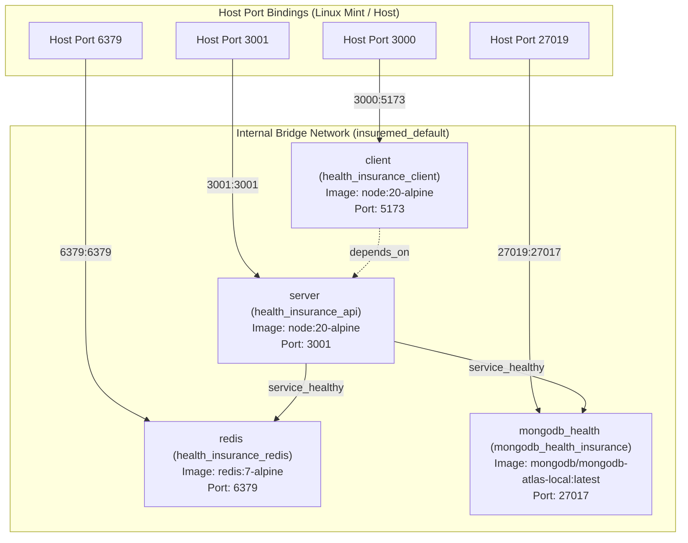

# 16. Docker and Deployment Guide

This document provides a technical reference for the multi-container orchestration architecture of **InsureMed**, covering Docker Compose configurations, Dockerfiles, volume persistence, container health dependencies, and production deployment considerations.

---

## 1. Container Topology & Orchestration Architecture

InsureMed is containerized into four coordinated services managed by Docker Compose:



---

## 2. Service Specifications

### 1. `redis` (Cache & Rate Limiting)
- **Image:** `redis:7-alpine`
- **Container Name:** `health_insurance_redis`
- **Host Port Binding:** `6379:6379`
- **Health Check:**
  ```yaml
  healthcheck:
    test: ["CMD", "redis-cli", "ping"]
    interval: 5s
    timeout: 3s
    retries: 5
  ```
- **Restart Policy:** `always`

### 2. `mongodb_health` (Database & Vector Engine)
- **Image:** `mongodb/mongodb-atlas-local:latest`
- **Container Name:** `mongodb_health_insurance`
- **Hostname:** `mongodb_health` (Required for internal replica set discovery)
- **Host Port Binding:** `27019:27017`
- **Environment Variables:**
  - `MONGODB_INITDB_ROOT_USERNAME=${MONGO_ROOT_USER:-admin}`
  - `MONGODB_INITDB_ROOT_PASSWORD=${MONGO_ROOT_PASSWORD:?Set MONGO_ROOT_PASSWORD in the root .env file}`
  - `MONGODB_INITDB_DATABASE=health_insurance`
- **Persistent Volumes:**
  - `mongodb_health_data:/data/db` (BSON data storage)
  - `mongodb_health_config:/data/configdb` (Replica set configuration)
  - `mongodb_mongot_data:/data/mongot` (Atlas Vector Search Lucene indexes)
- **Health Check:** Relies on the image's built-in Atlas readiness probe.

### 3. `server` (Backend REST API)
- **Build Context:** `./Server` (`Server/Dockerfile`)
- **Container Name:** `health_insurance_api`
- **Host Port Binding:** `3001:3001`
- **Environment Configuration:** Loaded from `./Server/.env` via `env_file`.
- **Health Dependencies:**
  ```yaml
  depends_on:
    redis:
      condition: service_healthy
    mongodb_health:
      condition: service_healthy
  ```
- **Volume Mounts:**
  - `./Server:/app` (Live bind-mount for development reload)
  - `/app/node_modules` (Anonymous volume to prevent host/container module pollution)
- **Command:** `npm run dev` (Runs Nodemon with automatic file-watch restarts)

### 4. `client` (Frontend React SPA)
- **Build Context:** `./Clients` (`Clients/Dockerfile`)
- **Container Name:** `health_insurance_client`
- **Host Port Binding:** `3000:5173`
- **Environment:** `VITE_API_URL: http://localhost:3001/api/v1`
- **Dependencies:** Depends on `server`.
- **Volume Mounts:**
  - `./Clients:/app` (Live bind-mount for React HMR)
  - `/app/node_modules` (Anonymous volume)
- **Command:** `npm start` (Runs `vite --host` binding to `0.0.0.0`)

---

## 3. Dockerfiles Deep Dive

### Backend Dockerfile (`Server/Dockerfile`)
```dockerfile
# Use Node 20 on lightweight Alpine Linux
FROM node:20-alpine

WORKDIR /app

# Cache package dependencies layer
COPY package*.json ./
RUN npm install

# Copy application source code
COPY . .

# Expose Express HTTP port
EXPOSE 3001

# Start development server
CMD ["npm", "run", "dev"]
```

> [!NOTE]
> **EBADENGINE Fix:**  
> The original Dockerfile contained `RUN npm install -g npm@latest`, which attempted to install npm 12+ on Node 20, causing `EBADENGINE` build failures. The updated Dockerfile uses Node 20's stable bundled npm client.

### Frontend Dockerfile (`Clients/Dockerfile`)
```dockerfile
# Use Node 20 for Vite React frontend
FROM node:20-alpine

WORKDIR /app

COPY package*.json ./
RUN npm install

COPY . .

# Expose Vite default port
EXPOSE 5173

# Start Vite dev server on all network interfaces
CMD ["npm", "start"]
```

---

## 4. Operational Commands

### Starting the Stack
To build images and launch containers in the background:
```bash
docker compose up -d --build
```

### Checking Container Health & Status
```bash
docker compose ps
```

### Viewing Container Logs
To stream combined logs across all services:
```bash
docker compose logs -f
```

To stream logs from a specific service:
```bash
docker compose logs -f server
docker compose logs -f mongodb_health
```

### Executing Commands Inside Containers
To run node scripts inside the running backend container (e.g., seeding the admin account):
```bash
docker compose exec server node seed/createAdmin.js
```

To open an interactive shell inside the server container:
```bash
docker compose exec server sh
```

### Stopping Services Safely
To stop all containers while **preserving all database records and volumes**:
```bash
docker compose stop
# or
docker compose down
```

> [!CAUTION]
> **Data Destruction Warning:**  
> Running `docker compose down -v` permanently removes the named volumes (`mongodb_health_data`, `mongodb_mongot_data`, `mongodb_health_config`), erasing all user accounts, active policies, and claims. Never use `-v` unless you intend to completely reset the system.

---

## 5. Production Deployment Considerations

While the current Docker Compose setup is optimized for local development and demonstration, the following architectural enhancements are recommended for enterprise production deployment:

### 1. Multi-Stage Frontend Build (Nginx)
In production, do not serve the frontend via Vite dev server. Instead, compile static assets and serve them via an Nginx Alpine container:
```dockerfile
# Stage 1: Build static bundle
FROM node:20-alpine AS builder
WORKDIR /app
COPY package*.json ./
RUN npm ci
COPY . .
RUN npm run build

# Stage 2: Serve via Nginx
FROM nginx:alpine
COPY --from=builder /app/dist /usr/share/nginx/html
COPY nginx.conf /etc/nginx/conf.d/default.conf
EXPOSE 80
CMD ["nginx", "-g", "daemon off;"]
```

### 2. Reverse Proxy & TLS Termination
Deploy a reverse proxy (e.g., Nginx, Caddy, Traefik, or AWS ALB) in front of the application:
- Handle HTTPS termination using Let's Encrypt SSL/TLS certificates.
- Route `/api/v1/` and `/api-docs` to port `3001` (backend).
- Route all other requests to port `80` (static frontend).
- Terminate unencrypted HTTP traffic and redirect to HTTPS.

### 3. Production Node Execution
- Run Express using `CMD ["node", "server.js"]` or with a process manager like **PM2** to handle automatic clustering and process restarts.
- Set `NODE_ENV=production` to suppress debug stack traces in API error responses.

### 4. Managed Cloud Database (MongoDB Atlas)
- Transition from containerized `mongodb-atlas-local` to a dedicated cloud **MongoDB Atlas M10+** cluster with automatic daily snapshots, high availability across multiple availability zones, and managed Atlas Search nodes.

### 5. Strict CORS Origin Whitelisting
Update `Server/app.js` to replace dynamic development origins with explicit production domains:
```javascript
app.use(
  cors({
    origin: process.env.CLIENT_URL || "https://insuremed.example.com",
    credentials: true,
  })
);
```
