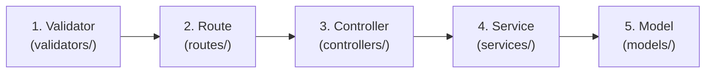

# 20. Development Guidelines

This document outlines the coding standards, architectural patterns, directory conventions, and step-by-step procedures for extending the **InsureMed** codebase.

---

## 1. Development Principles & Code Standards

### ECMAScript Modules (ESM) Native Execution
The backend runs in native ESM mode (`"type": "module"` in `Server/package.json`).
- Always use standard `import` / `export` syntax.
- **Mandatory File Extensions:** Internal relative imports in Node.js **must** include the `.js` extension:
  ```javascript
  // Correct
  import User from "../models/user.js";
  import AppError from "../utils/AppError.js";

  // Incorrect (will throw ERR_MODULE_NOT_FOUND)
  import User from "../models/user";
  ```

### Naming Conventions
- **Files & Folders:**
  - Backend: `camelCase.js` for controllers, services, middlewares (e.g., `claimController.js`, `ticketService.js`).
  - Models: `PascalCase.js` or `camelCase.js` (e.g., `DocumentChunk.js`, `user.js`).
  - Frontend Pages & Components: `PascalCase.jsx` (e.g., `DashboardOverview.jsx`, `BrandLogo.jsx`).
  - Frontend Services & Stores: `camelCase.js` (e.g., `authStore.js`, `claimService.js`).
- **Variables & Functions:** `camelCase` (e.g., `calculateRiskScore`, `userPlanTier`).
- **Constants & Enums:** `UPPER_SNAKE_CASE` (e.g., `PLAN_TYPES`, `ROLES`).

---

## 2. Adding a New Frontend Page

Follow this procedure to introduce a new page into the React application:

### Step 1: Create the Page Component
Create a new JSX file in the relevant subfolder under `Clients/src/pages/`:

```jsx
// Clients/src/pages/users/profile/UserSettings.jsx
import React from "react";
import { useAuthStore } from "@/stores/authStore";

export default function UserSettings() {
  const { user } = useAuthStore();

  return (
    <div className="p-6 max-w-4xl mx-auto space-y-6">
      <h1 className="text-2xl font-bold text-slate-800">Account Preferences</h1>
      <p className="text-slate-600">Manage settings for {user?.email}</p>
      {/* Component content */}
    </div>
  );
}
```

### Step 2: Register the Route in `Clients/src/routers/index.jsx`
1. Declare a lazy-loaded reference at the top of the file:
   ```jsx
   const UserSettings = lazy(() => import("@/pages/users/profile/UserSettings"));
   ```
2. Add the route under the appropriate layout hierarchy:
   ```jsx
   // Customer Portal route (inside dashboard children)
   {
     path: "settings",
     element: withSuspense(<UserSettings />)
   }
   ```
3. Test navigation by visiting `http://localhost:3000/dashboard/settings`.

---

## 3. Adding a New Backend Endpoint

To maintain architectural decoupling, follow the **Validator → Route → Controller → Service** pattern:



### Step 1: Define Input Validation Rules
Create or update validation rules in `Server/validators/`:

```javascript
// Server/validators/settingValidator.js
import { body } from "express-validator";

export const updateTaxValidator = [
  body("globalTaxRate")
    .isFloat({ min: 0, max: 100 })
    .withMessage("Global tax rate must be a percentage between 0 and 100."),
];
```

### Step 2: Implement the Service Method
Implement the database mutation inside `Server/services/`:

```javascript
// Server/services/settingService.js
import Settings from "../models/setting.js";
import AppError from "../utils/AppError.js";

export async function updateTaxRate(taxRate, userId) {
  const setting = await Settings.findOne();
  if (!setting) {
    throw new AppError("Global settings record not found", 404);
  }
  setting.globalTaxRate = taxRate;
  setting.updatedBy = userId;
  return await setting.save();
}
```

### Step 3: Implement the Controller Method
Handle the HTTP transport in `Server/controllers/`:

```javascript
// Server/controllers/settingController.js
import * as settingService from "../services/settingService.js";

export async function setGlobalTaxRate(req, res, next) {
  try {
    const { globalTaxRate } = req.body;
    const updatedSettings = await settingService.updateTaxRate(globalTaxRate, req.user._id);

    res.status(200).json({
      status: "success",
      message: "Global tax rate updated successfully",
      data: updatedSettings,
    });
  } catch (error) {
    next(error); // Forwards to globalErrorHandler
  }
}
```

### Step 4: Map the Route & Chain Middleware
Register the route in `Server/routes/`:

```javascript
// Server/routes/adminRoutes.js
import { updateTaxValidator } from "../validators/settingValidator.js";
import { validate } from "../middlewares/validateMiddleware.js";
import { protect, restrictTo } from "../middlewares/protect.js";
import { ROLES } from "../constants/roles.js";
import { setGlobalTaxRate } from "../controllers/settingController.js";

router.patch(
  "/settings/tax-rate",
  protect,
  restrictTo(ROLES.ADMIN),
  updateTaxValidator,
  validate,
  setGlobalTaxRate
);
```

### Step 5: Document in OpenAPI (`Server/openapi.yaml`)
Add the endpoint definition to `Server/openapi.yaml` to ensure it renders in Swagger UI at `/api-docs`.

---

## 4. Creating a Mongoose Model

When adding a new data entity:

1. Create `Server/models/ModelName.js`.
2. Define the schema with explicit types, required validation, and trimmed strings.
3. Configure performance indexes:
   ```javascript
   import mongoose from "mongoose";

   const prescriptionSchema = new mongoose.Schema(
     {
       patient: {
         type: mongoose.Schema.Types.ObjectId,
         ref: "User",
         required: true,
       },
       policy: {
         type: mongoose.Schema.Types.ObjectId,
         ref: "Policy",
         required: true,
       },
       medicationName: { type: String, required: true, trim: true },
       dosage: { type: String, required: true },
       dispensedAt: { type: Date, default: Date.now },
     },
     { timestamps: true }
   );

   prescriptionSchema.index({ patient: 1, dispensedAt: -1 });

   export default mongoose.model("Prescription", prescriptionSchema);
   ```

---

## 5. Branching & Code Review Practices

- **Feature Isolation:** Never commit directly to the `main` branch. Create a feature branch (e.g., `feature/prescriptions-module` or `fix/jwt-expiration`).
- **Pre-Commit Verification:** Run `npm run lint` and `npm run build` in `Clients/` before opening pull requests.
- **No Secrets Rule:** Ensure no `.env` files or hardcoded credentials are included in staged Git commits.
