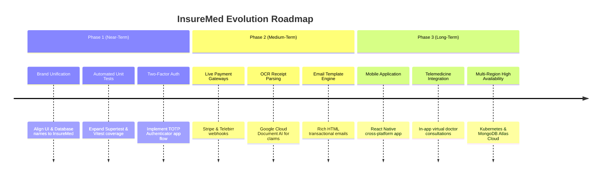

# 22. Project Roadmap

This document provides a realistic audit of **InsureMed**, clearly distinguishing verified, fully functional system capabilities from current limitations and planned future enhancements.

---

## 1. Verified Existing Capabilities (Current State)

The following capabilities have been thoroughly verified in the source code and operational container environment:

### Core Infrastructure & Architecture
- [x] Multi-container orchestration with Docker Compose (Frontend, Backend, Redis, MongoDB Atlas Local).
- [x] Isolated Docker networking with health-dependent startup sequencing.
- [x] Volume persistence for MongoDB data, cluster configuration, and Atlas vector indexes.
- [x] Rate limiting via Redis (`rate-limit-redis`) protecting authentication endpoints.
- [x] RESTful API running native ES modules on Express 5.1 with OpenAPI 3.0 Swagger UI at `/api-docs`.

### Authentication & Security
- [x] Salted password hashing using Bcrypt (10 salt rounds).
- [x] JWT authentication supporting dual transport: HTTP-Only cookies and Authorization headers.
- [x] Brute-force account lockout protection: 5 consecutive failed attempts trigger a 15-minute freeze.
- [x] Role-Based Access Control (`customer`, `admin`, `agent`).
- [x] Token invalidation upon subsequent password changes.
- [x] Instant SMTP bypass preventing network timeouts when mail servers are unconfigured.

### Insurance Business Operations
- [x] Insurance plan catalog browsing with multi-criteria filtering (category, type, pricing, ratings).
- [x] Actuarial risk score preview calculation for new plans (`POST /api/v1/plans/risk-score`).
- [x] Multi-step digital policy application with file uploads (identity and income documents).
- [x] Administrative underwriting queue with document inspection and approval/rejection reason logging.
- [x] Automated policy generation with immutable plan snapshots frozen at contract inception.
- [x] Reimbursement claim submission with receipt attachments.
- [x] Administrative claims adjudication queue (`Pending` → `Approved` / `Rejected`).
- [x] Policy renewal workflow with 365-day extension upon administrative approval.

### Support & Background Automation
- [x] Customer support ticketing with category and priority classifications.
- [x] Threaded ticket messaging between policyholders and support agents.
- [x] In-process 5-minute background cron job checking SLA deadlines (`Server/cron/escalation.js`).
- [x] Automatic 1-hour warning email alerts to assigned staff prior to SLA deadline expiration.
- [x] Overdue ticket escalation to `EMERGENCY` priority with administrative alert notifications.
- [x] Real-time customer notification center with unread badge tracking.

### Artificial Intelligence & Vector Search
- [x] Grounded policy document retrieval using MongoDB Atlas `$vectorSearch` and 768-dimensional embeddings.
- [x] Google Gemini 2.5 Flash conversational assistant with adversarial prompt guardrails and source citations.
- [x] Strict hallucination prevention: returns standardized fallback if documents do not contain the answer.

---

## 2. Known Current Limitations

The following items reflect current architectural constraints or intentional development compromises:

1. **Branding Inconsistencies:** The codebase uses **InsureMed** as its canonical repository name, but navigation logos render **OHIMS** and database settings default to **InsuTrack Pro**.
2. **Simulated Payment Gateways:** Policy applications and renewals accept payment method selections and transaction references, but do not yet integrate with live third-party payment gateways (e.g., Stripe, PayPal, or Telebirr).
3. **Manual Claim Verification:** Claim adjudication relies on manual inspection of attached invoice PDFs/images; automated OCR receipt data extraction is not yet integrated.
4. **Two-Factor Authentication (2FA) Incomplete:** The `User` model defines `twoFactorEnabled: Boolean`, but OTP token generation and authenticator app verification workflows are not yet implemented.
5. **Single-Node Database:** The development setup runs a single MongoDB Atlas Local container rather than a multi-node high-availability replica set.

---

## 3. Proposed Future Roadmap

### Phase 1: Quality, Security & Brand Alignment (Target: Q1 2027)
- **Brand Unification:** Standardize all navbar logos, footer texts, settings models, and AI system prompts to **InsureMed**.
- **Automated Test Coverage Expansion:** Add Supertest API integration tests for claims, applications, and auth lockout; add Vitest component tests for frontend stores.
- **Two-Factor Authentication (TOTP):** Implement QR-code generation and 6-digit TOTP validation (e.g., Google Authenticator) for administrative accounts.
- **Enhanced Role Permissions:** Expand the `agent` role with dedicated ticket assignment queues and partial claim review capabilities.

### Phase 2: Financial Integrations & Automation (Target: Q2 2027)
- **Third-Party Payment Gateways:** Integrate Stripe and PayPal webhooks for instant automated premium billing and renewals.
- **Automated Claims OCR:** Connect Google Cloud Document AI or Tesseract to extract line-item totals, dates of service, and provider tax IDs from uploaded claim receipts automatically.
- **Responsive HTML Transactional Emails:** Replace plaintext email notifications with responsive, branded HTML email templates.
- **Customer Feedback & Ratings:** Allow policyholders to rate closed support tickets and submit plan reviews.

### Phase 3: Ecosystem Expansion (Target: Q3-Q4 2027)
- **Cross-Platform Mobile App:** Deliver a native iOS and Android application using React Native, reusing existing Zustand stores and API services.
- **Hospital Network Portal:** Build a dedicated portal for network hospitals to verify member coverage in real time and submit direct-billing claims.
- **Telemedicine & Virtual Consultations:** In-app video appointments connecting insured members with certified healthcare practitioners.
- **Multi-Region Enterprise Deployment:** Helm charts and Kubernetes manifests for deploying InsureMed across distributed cloud clusters.
